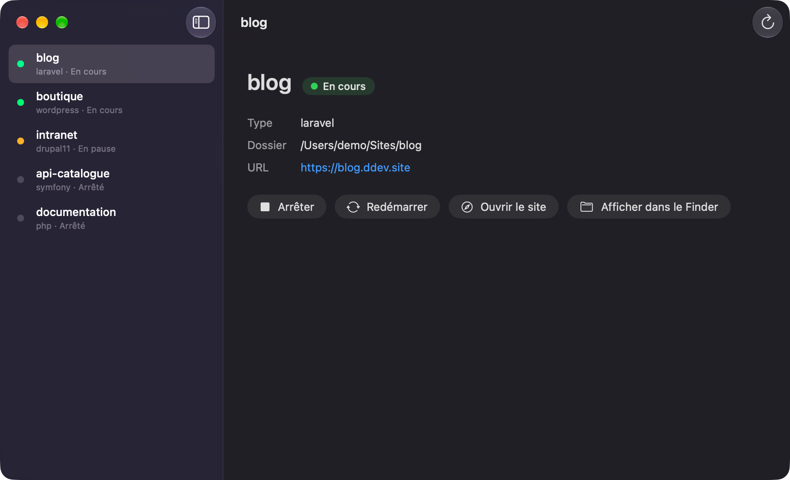
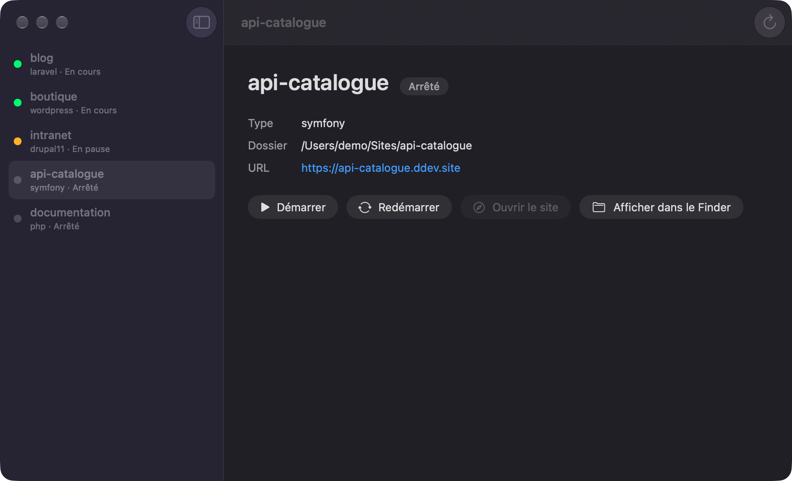
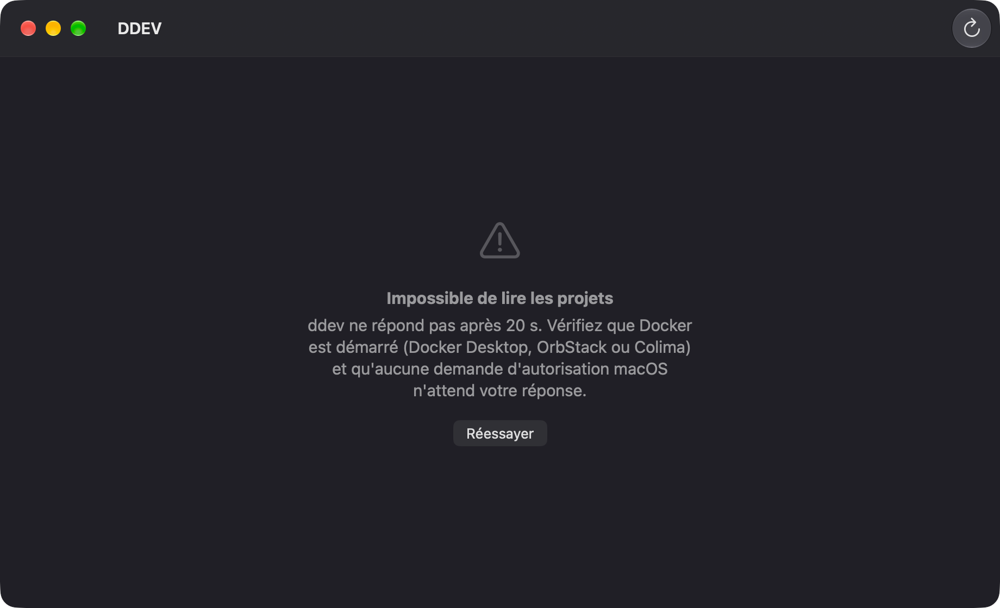

# DDEV-APP

Application macOS native (Swift/SwiftUI) pour gérer ses projets [DDEV](https://ddev.com) sans passer par le terminal.



## Objectif

Offrir une interface macOS native au-dessus de la CLI `ddev` : voir ses projets et leur état, les démarrer ou les arrêter, ouvrir leur URL et gérer leurs add-ons.

## Fonctionnalités actuelles

- Liste des projets DDEV avec leur état (en cours, arrêté, en pause)
- Fiche d'un projet : type, dossier, URL
- Démarrer, arrêter, redémarrer un projet ; ouvrir le site ; afficher le dossier dans le Finder (aussi depuis le menu contextuel de la liste)
- Mise à jour automatique de la liste quand un conteneur DDEV démarre, s'arrête ou devient sain, y compris après un `ddev start` lancé dans le terminal (écoute de `docker events`)
- Rafraîchissement manuel (⌘R)
- Message clair quand DDEV est introuvable ou ne répond pas (Docker arrêté, autorisation macOS en attente) ; le processus `ddev` bloqué est arrêté
- Modes clair et sombre

| Projet arrêté (mode clair) | ddev ne répond pas |
| --- | --- |
|  |  |

Les captures des projets utilisent le mode démo (projets fictifs) ; la dernière est prise avec une vraie installation.

## Prérequis

- macOS 14 (Sonoma) ou plus récent
- [DDEV](https://ddev.readthedocs.io/en/stable/users/install/ddev-installation/) installé (`ddev` dans `/opt/homebrew/bin`, `/usr/local/bin` ou le `PATH`)
- Un fournisseur Docker : [Docker Desktop](https://www.docker.com/products/docker-desktop/), [OrbStack](https://orbstack.dev) ou [Colima](https://github.com/abiosoft/colima)
- Xcode 16 ou plus récent pour compiler l'app (une toolchain Swift 6 suffit pour `DDEVKit`)

## Structure

| Dossier | Rôle |
| --- | --- |
| `Sources/DDEVKit` | Bibliothèque sans interface : modèles, client de la CLI `ddev`, état `@Observable` |
| `Tests/DDEVKitTests` | Tests XCTest de `DDEVKit` |
| `DDEVApp` | Application SwiftUI (projet Xcode qui dépend du package local) |
| `docs/screenshots` | Captures d'écran du README |

## Compiler et tester

Bibliothèque et tests :

```bash
swift build
swift test
```

Application :

```bash
xcodebuild -project DDEVApp/DDEVApp.xcodeproj -scheme DDEVApp -derivedDataPath build build
open build/Build/Products/Debug/DDEVApp.app
```

Ou ouvrez `DDEVApp/DDEVApp.xcodeproj` dans Xcode et lancez le schéma `DDEVApp`.

### Mode démo

Pour essayer l'interface sans DDEV ni Docker, lancez l'app avec l'argument `--demo` (des projets fictifs dont l'état change quand on les démarre ou les arrête) :

```bash
open build/Build/Products/Debug/DDEVApp.app --args --demo
```

Dans Xcode : *Product > Scheme > Edit Scheme > Run > Arguments*, cochez `--demo`.

## Distribution

L'app n'utilise pas l'App Sandbox : un processus lancé par une app sandboxée hérite de son sandbox, et `ddev` doit pouvoir écrire dans `~/.ddev`, dans les dossiers des projets et joindre le socket Docker. Elle est donc prévue pour une distribution hors Mac App Store (Developer ID, notarisation, Hardened Runtime activé).

Au premier accès à un projet rangé dans Documents, Bureau ou Téléchargements, macOS demande l'autorisation à DDEV-APP. Tant que la demande reste sans réponse, `ddev` est bloqué : cliquez sur « Autoriser », puis sur « Réessayer » dans l'app. En développement, l'app est signée localement : macOS peut reposer la question après une recompilation.

## Feuille de route

### 1. Architecture

- [x] Cœur de `DDEVClient` : `listProjects()` async, exécution de `ddev` derrière un protocole simulable, erreurs typées, tests unitaires associés
- [x] Application SwiftUI (projet Xcode) qui s'appuie sur `DDEVKit`
- [x] État partagé `@Observable` alimenté par `DDEVClient`
- [x] Actions sur un projet : `start`, `stop`, `restart`, ouverture de l'URL

### 2. Surveillance Docker et DDEV

- [x] Délai maximal sur les appels `ddev`, avec arrêt forcé du processus bloqué
- [x] Flux d'events `docker events` pour rafraîchir l'état automatiquement (rafales regroupées en un seul `ddev list`, reconnexion quand Docker redémarre)
- [ ] Détection du fournisseur Docker (Docker Desktop, OrbStack, Colima) et de son état
- [ ] Notifications lors d'un changement d'état

### 3. Gestion des add-ons

- [ ] Liste des add-ons installés par projet
- [ ] Recherche et installation d'add-ons (`ddev add-on get`)
- [ ] Suppression d'add-ons

### 4. Tests

- [x] Tests de l'état `@Observable` (`ProjectStore`)
- [ ] Tests d'intégration contre une vraie installation DDEV
- [ ] Tests d'interface de l'application

## Licence

[MIT](LICENSE)
